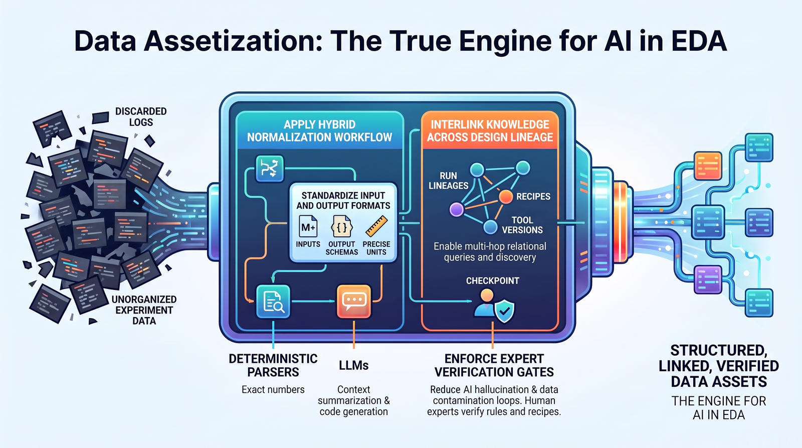

# Recommendations on Leveraging AI in the EDA Domain

### The Bottleneck Is Not LLM Performance, but the Data We Give the LLM

> **English** | [한국어](EDA_AI_Recommendations_KO.md)
> 
> **Author:** Kyoungman Kim · **Version:** 1.0 (draft v31) · **Date:** 2026-10-18 · **License:** [CC BY 4.0](LICENSE)

## Contents

- [Abstract](#abstract)
- [1. Introduction: The Structural Peculiarities of the EDA Domain](#1-introduction-the-structural-peculiarities-of-the-eda-domain)
- [2. Background: The Trajectory of AI Adoption in EDA](#2-background-the-trajectory-of-ai-adoption-in-eda)
  - [2.1 RL-Based Optimization (Mature Stage)](#21-rl-based-optimization-mature-stage)
  - [2.2 LLM-Based Flow Development (Early Stage)](#22-llm-based-flow-development-early-stage)
- [3. Problem Statement: The Reality of the Domain Gap](#3-problem-statement-the-reality-of-the-domain-gap)
- [4. Comparative Review of Augmentation Approaches](#4-comparative-review-of-augmentation-approaches)
  - [4.1 LLM Fine-Tuning (DAPT / SFT / LoRA)](#41-llm-fine-tuning-dapt--sft--lora)
  - [4.2 RAG (Retrieval-Augmented Generation)](#42-rag-retrieval-augmented-generation)
  - [4.3 LLM Wiki](#43-llm-wiki)
  - [4.4 Other Approaches Worth Reviewing](#44-other-approaches-worth-reviewing)
  - [4.5 Comparison Summary](#45-comparison-summary)
- [5. Data Assetization: The Real Bottleneck](#5-data-assetization-the-real-bottleneck)
  - [5.1 Assets Being Lost](#51-assets-being-lost)
  - [5.2 Normalization: Dividing Roles Between LLMs and Deterministic Parsers](#52-normalization-dividing-roles-between-llms-and-deterministic-parsers)
  - [5.3 A Unified Format: Which Format?](#53-a-unified-format-which-format)
- [6. Link Structure: Turning Data into Information](#6-link-structure-turning-data-into-information)
  - [6.1 Types of Links](#61-types-of-links)
  - [6.2 A Concrete Scenario](#62-a-concrete-scenario)
  - [6.3 Turning Recipes into Assets](#63-turning-recipes-into-assets)
  - [6.4 Where Links Stop: Customer Boundaries](#64-where-links-stop-customer-boundaries)
  - [6.5 How Records, Links, and the Wiki Divide the Work](#65-how-records-links-and-the-wiki-divide-the-work)
- [7. The Positive Feedback Loop](#7-the-positive-feedback-loop)
- [8. Conclusion](#8-conclusion)
- [References](#references)
- [Disclaimer](#disclaimer)

## Abstract

The EDA (Electronic Design Automation) industry has evolved under four constraints: operation within air-gapped networks, proprietary mathematical algorithms and accumulated empirical know-how, tool outputs whose ownership and permitted use are governed by customer contracts, and reliability that matters as much as performance. These constraints make it difficult to adopt general-purpose LLMs as-is. General-purpose LLMs have learned the general principles of semiconductor design, but are unlikely to have reliably learned the internal workings of the algorithms each EDA company has built, or the know-how for operating its tools. The result can go beyond simple hallucination: the model may confidently present solutions that are syntactically complete yet physically and engineeringly meaningless.

This paper compares the strengths and weaknesses of three representative approaches for closing this gap — fine-tuning, RAG (retrieval-augmented generation), and LLM Wiki — against the constraints of the EDA domain, and additionally reviews agent-based tool calling over MCP (Model Context Protocol) and knowledge-graph approaches. It then offers a more fundamental recommendation. **The most undervalued asset an EDA company holds is not its algorithms but the experiment reports and log files accumulated over decades, and the system for normalizing, linking, and archiving them is the real bottleneck for LLM adoption.** By normalizing raw data into a unified format and building a link structure that connects run lineage, recipes, QoR, and tool versions, we can suppress hallucination by grounding answers in verified facts, while also extracting insights from patterns we had not recognized. These insights are fed back into the data, forming a positive feedback loop of tool improvement and recipe enrichment. In conclusion, model capability matters, but the variable most often overlooked in increasing AI adoption in EDA is **the level of structure in the data the model can reference**.

**Keywords** : EDA, LLM, RAG, Domain Adaptation, Knowledge Graph, PPA, Data Normalization, Agentic AI  
**A note on citations:** Bracketed numbers in the text correspond to the references at the end. Because the evidence differs in nature, the references are labeled as follows. [Paper] peer-reviewed or arXiv preprint · [Media] industry media coverage · [Vendor] official company material · [Commentary] technical blogs and industry commentary (lower level of verification; use for directional reference only) · [Analyst] industry analyst firm material · [Primary] original author's source document · [Implementation] open-source implementations · [Benchmark] independent benchmark reports. Sentences without citations reflect the author's views based on practical experience; in particular, Section 5.2 and Chapter 7 are explicitly the author's recommendations.

## 1. Introduction: The Structural Peculiarities of the EDA Domain

Development and use in the EDA field take place mostly within air-gapped networks. This stems not merely from security policy but from the structure of the industry itself. *(This chapter is a problem statement based on the author's practical observations.)*

**First, the nature of the assets is different.** EDA tools advance through each company's proprietary mathematical algorithms and long-accumulated empirical assets. Approximation techniques in timing engines, heuristics in placement algorithms, cost functions in routing — these are not published in papers, and even when they are, the actual implementation and tuning parameters are a separate matter.

**Second, rights to the outputs usually sit with the customer.** Rights to and permitted uses of netlists, layouts, reports, and records derived from them are governed by customer contracts, licenses, and applicable law, so using this data for training can create contractual and legal obligations. And once the data has influenced shared model weights, reliably isolating or removing that influence may require retraining and cannot be guaranteed by ordinary access controls, which makes the decision hard to walk back.

**Third, reliability is equal to or more important than performance.** Given the enormous development cost and time invested, a tool that is "sometimes brilliant but sometimes wrong" is not acceptable. Considering the mask cost of a single tape-out, a suggestion with 95% accuracy is not a 5% risk but a risk to the entire project.

**Fourth, dependence on specialized personnel is high.** Operating the tools requires people who combine semiconductor design knowledge with tool operation knowledge, and more importantly, **experts capable of verifying the tools' outputs** are indispensable. This verification step does not disappear with the introduction of AI. On the contrary, as the volume of AI-generated output grows, the verification bottleneck deepens.

These four constraints serve as the evaluation criteria for the rest of the discussion. Any approach to AI adoption must pass the following questions: *Does it work in an air-gapped network? Can it isolate customer data? Can the basis for its results be traced? Does it fit naturally into the expert verification loop?*

## 2. Background: The Trajectory of AI Adoption in EDA

AI adoption in EDA is nothing new. Its character, however, has changed significantly in recent years.

### 2.1 RL-Based Optimization (Mature Stage)

Earlier adoption focused mainly on reinforcement-learning-based design space exploration. Synopsys DSO.ai, Cadence Cerebrus, and Google's AlphaChip line are representative, and the goal was clear: **PPA improvement and shorter exploration time.** The approach replaces the hundreds of manual runs needed to find a recipe with automated exploration. This area is already part of production flows.

### 2.2 LLM-Based Flow Development (Early Stage)

By contrast, EDA flow development using LLMs is still at an early stage. Nevertheless, progress is fast.

* **ChipNeMo (NVIDIA, 2023–)** — Combined a custom tokenizer, domain-adaptive continued pretraining (DAPT), supervised fine-tuning (SFT) on domain instructions, and a domain-adapted retrieval model. It was evaluated on three use cases — an engineering assistant chatbot, EDA script generation, and bug summarization/analysis — and the largest 70B model reportedly outperformed the GPT-4 of the time on the first two use cases without degrading general capabilities [[1]](#ref-1). The authors stated that DAPT was the main technique driving the performance gains and report more than 70% correctness on simple EDA scripts [[1]](#ref-1). The appendix shows how much that figure depends on conditions: on the four automatically graded 1–4-line benchmarks, the RAG-assisted ChipNeMo-70B-Steer reached Pass@5 of 77%/36% (Python tool, Easy/Medium) and 84%/85% (Tcl tool, Easy/Medium), whereas the same model without RAG scored 49%/32% and 45%/56% [[1]](#ref-1).
* **ChatEDA / VeriGen / ChipLlama family** — Fine-tuning approaches for EDA script generation and HDL code generation. The LLM4EDA survey organizes this family into three branches: fine-tuning, domain-adaptive pretraining, and prompt engineering [[2]](#ref-2). ChipLlama was designed, via Llama3-based hybrid instruction tuning, to serve as the "brain" of an EDA flow automation agent [[3]](#ref-3).
* **AutoEDA (2025–2026)** — A microservice-style agent architecture that controls the RTL-to-GDSII flow in natural language using MCP. Task decomposition, tool selection, and error handling were each separated into MCP servers, and a locally fine-tuned agent was integrated to ensure confidentiality. On the authors' own benchmarks, token use fell by about 97% relative to their in-context-learning setup, and accuracy rose by up to 9.9× over the naive baselines they defined; these are best-case figures, not independent reproductions [[4]](#ref-4). The related MCP4EDA, which its authors describe as the first MCP server to let LLMs control a complete open-source RTL-to-GDSII flow, drives tools such as Yosys, OpenLane, and KLayout through structured tool calls [[5]](#ref-5).
* **Industry trends (DAC 2026)** — In EE Times' analysis of the DAC 2026 AI landscape, IP lifecycle management and **companies providing MCP and RAG servers were classified as an independent layer called "design data and infrastructure."** It is telling that this layer was defined as "the governed context every agent stands on" [[6]](#ref-6).
* **Siemens EDA** — Stated that because feeding large logs wholesale into the context saturates the window, it applies what it calls a "dynamic RAG" approach that queries and retrieves only the necessary information. Subflows are composed like Lego blocks, and a supervisor agent aggregates results via MCP to decide the next step [[7]](#ref-7).
* **Cadence** — Presented an industry roadmap by defining autonomous design in five levels (optimization AI → conversational LLM → complex reasoning → agentic workflows → full autonomy) [[8]](#ref-8). At Computex 2026, the company announced that its ChipStack AI Super Agent had reached Level 5, with early-access availability planned for the second half of 2026 [[9]](#ref-9).

What stands out is that the industry's center of gravity is **shifting from "smarter models" to "better-organized context."** The emergence of the context-supply tier as a separate industry layer in the DAC 2026 landscape is one sign of this [[6]](#ref-6).

## 3. Problem Statement: The Reality of the Domain Gap

General-purpose LLMs have thoroughly learned the fundamentals of semiconductor design — the definitions of setup/hold, the concept of a clock tree, the structure of a standard cell library. What they are unlikely to have learned reliably is the following:

1. **The assumptions underlying the internal algorithms** of a specific EDA tool
2. **Which option combinations backfire under which conditions** (rules of thumb not found in documentation)
3. **Version-specific behavior differences and known issues** of that tool
4. **The context** of customer designs (process, libraries, conventions for constraints)

If optimization is delegated to an LLM in this state, two kinds of failure occur. One is the well-known **hallucination** — generating commands or options that do not exist. This is actually the lucky case: running it produces an immediate error, so it is filtered out right away.

The second is more dangerous: **solutions that are syntactically valid and even execute, but are engineeringly meaningless.** For example, in response to an instruction to improve WNS, the model generates a script that relaxes timing constraints, or applies an optimization valid only at a specific corner globally. Because such outputs do not raise errors, they **depend entirely on the expert verification step** mentioned earlier. Here arises the paradox: AI introduced to reduce the verification load ends up increasing it. *(These are generic hypothetical failure modes constructed for illustration, not incidents or behaviors observed in any identified company, customer, tool, or project. The paradox framing is the author's view.)*

Therefore, the question is not "Will it be solved once LLMs get smarter?" **Much of this proprietary, version-specific, customer-contextual knowledge is unlikely to be reliably represented in public base models, and where fragments do appear, their freshness and provenance cannot be assumed.**

## 4. Comparative Review of Augmentation Approaches

Below are the approaches that can be considered to address this gap.

### 4.1 LLM Fine-Tuning (DAPT / SFT / LoRA)

An approach that updates the model weights themselves with domain data.

**Strengths**

* **Internalization of domain vocabulary** — Domain-specific tokenizers improve tokenization efficiency for specialized terms, and continued pretraining aligns the model with the vocabulary and context of the domain [[1]](#ref-1)[[10]](#ref-10). The ChipNeMo authors concluded that DAPT was the main driver of performance gains [[1]](#ref-1).
* **Context savings at inference** — Because knowledge resides in the weights, material does not need to be loaded into the prompt for every query. Fine-tuning has a high upfront training cost, but per-query cost falls as query volume grows, and one comparison places the break-even point at roughly 100K–1M queries depending on model size and architecture [[11]](#ref-11). The actual threshold is deployment-specific and should be calculated from measured workload, serving utilization, data-preparation cost, and maintenance cost.
  * **Case study: NVIDIA's total cost of ownership (TCO) analysis** — An NVIDIA study compared ChipNeMo-70B with ChatGPT-4 Turbo and Claude 3 Opus on Tcl script generation for an industry-standard STA tool [[12]](#ref-12). Its workload model assumed 175 users issuing 15–50 queries a day over a 120-day window (labeled as roughly six months in the paper), with 1,000 tokens per query at API list prices. Adapting ChipNeMo to this task took about 100 A100 GPU-hours of DAPT on a 120M-token task-relevant subset and 4 GPU-hours of SFT on 5M tokens—roughly \$208 at Azure rates—though this covers only the task-specific slice; the full DAPT run for ChipNeMo-70B took about 20,500 A100 GPU-hours [[1]](#ref-1). Under the study's assumptions—counting the roughly $208 task-specific adaptation charge but not amortizing the original full DAPT run—the modeled ChipNeMo cost came out **18–25× lower than ChatGPT-4 Turbo** and **24–33× lower than Claude 3 Opus**, which the authors summarize as a **90–95% TCO reduction** (the ratios themselves imply roughly 94–97%, and the paper does not show how the range was derived); **the gap widened with scale as the fixed training cost was spread over more queries**. On a human-rated Tcl coding benchmark, ChipNeMo scored the highest accuracy (79% vs. 70% and 68%) with the fastest inference, although ChatGPT-4 Turbo showed the lowest hallucination rate (2%) [[12]](#ref-12). That said, this is an in-house study in which NVIDIA evaluated its own model, and the generated outputs were not published.
* **Strong at fixing behavior and format** — Practitioner assessments report that fine-tuning yields meaningful improvement in adhering to output specifications that are hard to enforce by prompting alone, such as strict JSON or function-call formats [[13]](#ref-13). Tcl idioms and in-house scripting conventions fall into this category.
* **On-prem small-model operation** — Models can be specialized and distilled to a size that runs inside an air-gapped network. AutoEDA's adoption of a locally fine-tuned agent for confidentiality follows the same logic [[4]](#ref-4).
* **Falling cost barriers** — Lightweight fine-tuning methods such as LoRA (low-rank adaptation) and QLoRA (quantized LoRA, which applies it to a quantized model) freeze the existing model weights and train only small auxiliary weights (adapters). With far fewer parameters to train, GPU memory and training time drop sharply, and the result is a single small adapter file that can be detached or swapped for another when no longer needed [[10]](#ref-10). Being cheap to train, however, is not the same as being good at instilling domain knowledge (see the disadvantages below).

**Weaknesses**

* **Mismatch in knowledge update cycles** — Retraining is required whenever facts change. Putting frequently updated knowledge into weights is a pattern the industry advises against [[10]](#ref-10)[[14]](#ref-14).
* **Inefficient and riskier for injecting facts** — Fine-tuning on a modest instruction dataset does not reliably teach new facts, and it has been noted to make models **more confidently wrong** on questions outside the training scope [[11]](#ref-11)[[13]](#ref-13). In a domain where reliability comes first, this is a high risk. Large-scale continued pretraining can instill domain knowledge, as ChipNeMo's DAPT did, but it costs thousands of GPU-hours and still leaves that knowledge frozen at training time [[1]](#ref-1). Cutting that cost with LoRA reduced the benefit. The ChipNeMo authors ran DAPT on LLaMA2-13B with two adapters of different sizes (26.4M and 211.2M trainable parameters, about 0.2% and 1.6% of the model), and domain-task accuracy came out clearly lower than with DAPT that trained the full model [[1]](#ref-1).
* **No native source traceability** — The model cannot natively point to the documents behind an answer. This is the key reason RAG is preferred in regulatory and verification environments that require audit trails [[14]](#ref-14).
* **Customer data isolation problem** — Once customer-owned data is blended into weights, removing its influence from the weights cannot be reliably guaranteed short of retraining without that data, and role-based access control cannot be enforced inside the model [[11]](#ref-11). *(The implications for EDA contract structures are the author's interpretation.)*
* **Dataset construction cost** — One practitioner guide cites roughly 500–2,000 high-quality examples for style or format tuning and 5,000–50,000 for domain reasoning, with data curation as the main effort [[11]](#ref-11); in practice this also means ML staff and a labeling pipeline. The people who can build these are, in the end, the very experts mentioned earlier.

### 4.2 RAG (Retrieval-Augmented Generation)

An approach that leaves the weights unchanged and retrieves relevant material at query time to insert into the context.

**Strengths**

* **Updates without retraining and freedom to swap models** — Changes to source data can be reflected without retraining the model, once ingestion, re-indexing, and cache invalidation have run, and the base model can be swapped freely. For this reason, several 2026 practitioner guides treat RAG as a practical starting point when facts change frequently [[10]](#ref-10)[[14]](#ref-14).
* **Source citation and audit trails** — RAG can attach supporting documents to each answer, but this does not happen on its own. The system has to record which documents were retrieved and which parts of them were used, and check that each citation the model produces actually matches the content of that part, since models sometimes cite documents that do not support the claim. Implemented this way, every answer can be traced back to its evidence, which helps meet audit-trail requirements [[14]](#ref-14). This makes RAG one of the approaches that can address the "traceability" criterion defined in Chapter 1; the comparison table in Section 4.5 lists the conditions under which Wiki and tool-call approaches can do the same.
* **Access control** — Data isolation is possible by separating indexes per customer and per project. Frequently changing knowledge or the need for role-based access control are presented as typical conditions for choosing RAG [[11]](#ref-11).
* **Hallucination suppression** — Grounding generation on relevant retrieved documents can reduce some factual errors [[14]](#ref-14), but it does not guarantee faithfulness: retrieval misses, noisy context, and unsupported generation remain possible.

**Weaknesses**

* **Retrieval quality caps performance** — If the knowledge base is stale or poorly structured, hallucinations remain regardless of architecture. It is repeatedly pointed out that **no choice of architecture can compensate for poor data—flaws in the source only propagate further** [[14]](#ref-14). Gartner's figures point the same way: a Gartner survey of data management leaders found that 63% of organizations either lacked, or were unsure whether they had, data management practices suited to AI, and Gartner predicts that through 2026, organizations will abandon 60% of AI projects not backed by AI-ready data [[15]](#ref-15). This is the core argument leading into Chapter 5.
* **Limits in capturing relationships** — RAG works by fetching document chunks that resemble the question, so it finds "similar" pieces well but misses pieces that are "connected." Comparative commentary accordingly describes it as strong on questions answered from a single place (e.g., "What was r042's WNS?") but weak on questions that require stepping through several places in turn (e.g., "Did the library change cause r042's WNS to degrade?") or scanning everything (e.g., "Which failure type recurs most often?") [[16]](#ref-16)[[17]](#ref-17). Storing the relationships between documents as a graph (GraphRAG, Section 4.4) emerged to address this weakness, but benchmark results show the graph approach is not always better; it depends on the task [[18]](#ref-18).
* **Not uniformly helpful for code generation** — In ChipNeMo's EDA script evaluation, retrieved API descriptions raised Pass@5 on easy and medium tasks, but on hard, multi-API tasks the human-rated score fell from 3.6 to 2.3 for the Python tool and from 2.9 to 0.8 for the Tcl tool; the authors point to the difficulty of coupling existing retrieval techniques with non-natural-language tasks such as code generation [[1]](#ref-1).
* **The size problem of EDA logs** — A single P&R run commonly produces a log hundreds of thousands of lines long, most of it repetitive progress messages *(author's practical experience)*. Feeding such logs in wholesale saturates the context immediately. Larger context windows do not remove the problem: every query then processes more tokens, raising cost and response time, and the few lines of warnings or figures that matter are buried among the repetition. Nor does the usual RAG approach of cutting logs into fixed-size chunks and retrieving similar ones fit well, because what is needed from a log is not a sentence that resembles the question but information that has to be **selected by condition**, such as a figure from a specific stage or a specific error code. That is why Siemens chose to query only the information it needs rather than loading logs and design files wholesale, an approach it calls "dynamic RAG" [[7]](#ref-7). This is closer to the tool calling of Section 4.4 than to vector search, and it works best when what is being queried is structured, like the normalized records of Chapter 5. Queries built on predefined conditions can miss anomalies nobody anticipated, however, which is one reason to keep the raw logs of failing and anomalous runs (Section 5.1).
* **Operating cost** — Increased tokens per query, vector DB maintenance, and re-indexing burdens are ongoing [[13]](#ref-13).

### 4.3 LLM Wiki

Instead of re-retrieving source text for every query, the LLM **"compiles" the raw material once into a persistent, interlinked wiki and continuously maintains it**. Its philosophy differs from RAG in that knowledge is distilled up front and kept current, instead of being reconstructed each time a question is asked. Karpathy formalized this as the LLM Wiki pattern in 2026 [[19]](#ref-19), and several open-source implementations have followed [[20]](#ref-20)[[21]](#ref-21).

**Strengths**

* **Normalization and summarization applied upfront** — Because knowledge is compiled once and maintained, repeated processing of raw sources at lookup time can be reduced and expression kept more consistent [[19]](#ref-19)[[21]](#ref-21). The benefit is expected to be largest for noisy raw material such as logs and reports, but it should be validated against a RAG baseline on EDA workloads.
* **Humans can read and review it** — Since the output is Markdown documents, experts can read and edit them directly. **The value of this in EDA is easily underestimated.** A vector index is less directly inspectable by domain experts than curated Markdown pages, which can be reviewed line by line, making this the most natural touchpoint for bringing "verification experts" into the AI pipeline. *(This assessment in the EDA context is the author's view.)*
* **Preservation of relationships** — Links between pages are themselves representations of relationships. Some implementations derive a lightweight link graph as a by-product, using links, source overlap, and type affinity as signals [[20]](#ref-20). This may deliver part of the benefit of a full knowledge graph at lower build cost, although that trade-off has not been independently benchmarked.
* **Version control and source tracing** — Some implementations maintain source traceability and typed YAML frontmatter for each page [[20]](#ref-20)[[22]](#ref-22). Managed with Git, change history and accountability can be preserved.

**Weaknesses**

* **Errors in the compile step become entrenched** — If the LLM misinterprets during summarization, that error is perpetuated. Designs should mandate source trace links on every page and reference original tables rather than summarizing numbers. *(The design prescription is the author's recommendation.)*
* **Maintenance ownership is required** — Freshness is not maintained automatically. The pattern grew out of a practical failure: document stores that are populated once and never curated degrade over time into outdated and self-contradicting collections [[22]](#ref-22). That origin itself shows the maintenance pipeline is the essence, not an add-on.
* **Initial build cost** — Upfront investment is needed for schema design and establishing curation criteria [[22]](#ref-22).

### 4.4 Other Approaches Worth Reviewing

**(a) Agents + Tool Calling (MCP)** — Instead of injecting knowledge into the model, **let the model obtain facts by calling tools directly**. MCP is a JSON-RPC 2.0–based protocol in which servers expose tools, resources, and prompts through a standard interface [[23]](#ref-23), which reduces bespoke integration work as tools evolve. In EDA, AutoEDA and MCP4EDA have applied this to the RTL-to-GDSII flow [[4]](#ref-4)[[5]](#ref-5). However, since there are empirical reports that even state-of-the-art models do not fully utilize MCP tools [[24]](#ref-24), careful design of tool-call permissions, failure handling, and guardrails for irreversible commands is essential.

**(b) GraphRAG / Knowledge Graphs** — Explicitly structure entities and relationships. The evidence on benefit is mixed: Xiang et al.'s GraphRAG-Bench (arXiv:2506.05690; not to be confused with the same-named benchmark of arXiv:2506.02404) starts from reports that GraphRAG frequently underperforms vanilla RAG on real-world tasks and systematically analyzes the conditions under which graph structure actually helps [[18]](#ref-18). Graph construction has traditionally been far more expensive, since an LLM must process every chunk to extract entities and relationships; Microsoft Research reports that its LazyGraphRAG variant brings indexing cost down to the level of vector RAG, about 0.1% of full GraphRAG (vendor-reported) [[25]](#ref-25). A practical option is **a hybrid that routes between vector search and graph traversal depending on query type**, a common design pattern in current practice [[17]](#ref-17)[[26]](#ref-26).

**(c) Context Engineering / Prompt Optimization** — The lowest-cost option, and recent foundation models handle much of what previously required fine-tuning without additional training [[10]](#ref-10)[[11]](#ref-11). Whatever approach is chosen, it is worth trying as a first step.

**(d) Distillation** — Transferring the capabilities of frontier models to smaller, cheaper models is cited as one of the legitimate uses of fine-tuning [[10]](#ref-10). It is a valid option for EDA environments in terms of air-gapped on-prem operation and inference cost.

### 4.5 Comparison Summary

*The table below is the author's reconstruction of the assessments in [[1]](#ref-1)[[4]](#ref-4)[[10]](#ref-10)[[11]](#ref-11)[[13]](#ref-13)[[14]](#ref-14)[[16]](#ref-16)[[17]](#ref-17)[[18]](#ref-18)[[20]](#ref-20)[[25]](#ref-25) from the standpoint of the EDA domain.*

| Criterion                        | Fine-Tuning                           | RAG                                                     | LLM Wiki                                                          | Agent/MCP                                          |
| -------------------------------- | ------------------------------------- | ------------------------------------------------------- | ----------------------------------------------------------------- | -------------------------------------------------- |
| Ease of knowledge updates        | Low (retraining)                      | High                                                    | Medium (recompile)                                                | High (real-time lookup)                            |
| Source traceability              | Not native; needs separate provenance | Feasible if source documents and locations are recorded | Feasible if pages keep source links                               | Feasible if tool calls and results are logged      |
| Customer data isolation          | Hard after mixed-data training        | Feasible with enforced tenant indexes/filters           | Feasible with repository and access-control-list (ACL) separation | Depends on tool authorization and server isolation |
| Initial build cost               | High                                  | Low                                                     | Medium                                                            | Medium                                             |
| Per-query operating cost         | Low                                   | High                                                    | Medium                                                            | Medium–High                                        |
| Relational / multi-hop reasoning | Weak                                  | Weak                                                    | Medium                                                            | Medium                                             |
| Expert verification touchpoint   | Model and evaluation review           | Retrieved evidence + answer review                      | **Direct page review**                                            | Tool-call and result review                        |
| Output format stability          | **Very high**                         | Medium                                                  | Medium                                                            | High                                               |

**Reading the table**

First, the table is not a benchmark that measured the four approaches under the same conditions. It collects the relative tendencies that various sources broadly agree on. Build cost, per-query cost, and output format stability in particular vary widely with implementation choices.

* **Model size**: The larger the model, the more steeply the training cost of fine-tuning rises.
* **Volume of documents to search**: The more documents there are, the more it costs to build and organize RAG and the wiki.
* **Reranking**: A step that takes the candidate documents returned by retrieval and reselects them with a more precise model. It raises accuracy, but because it runs a model once more for every query, it increases per-query cost.
* **Constrained decoding**: A technique that, while the model generates output, blocks any token that does not fit a required format such as a JSON schema. With it, output format can be enforced almost reliably without fine-tuning, which largely closes the gap in "output format stability" where fine-tuning leads in the table.

Second, isolation marked "feasible" in the table does not become safe on its own. It means the structure allows isolation; if the operating configuration is wrong, data still leaks. There are three typical paths.

* **A misconfigured search filter**: RAG searches with conditions such as "only this customer's documents." If a document is missing its customer tag, or the condition is written wrongly, log fragments from another customer slip silently into the results.
* **A cache shared across customers**: For speed, systems store the answers to frequently asked questions. If that store is not separated by customer (tenant), an answer built from one customer's data can go out unchanged to another customer who asks a similar question.
* **A tool server with overly broad permissions**: If a tool server that an agent calls runs with access to every project, nothing stops a request for the wrong path when the model makes one. A tool server should hold only the permissions the current project needs.

All three paths arise from operating configuration rather than from the approach itself. The customer-boundary principles of Section 6.4 and the `governance` fields in the example of Section 5.3 are there to prevent such leaks.

**Recommendation** : This is not a matter of choosing one of these four options. Practitioner guides consistently observe that most production systems converge on hybrids [[10]](#ref-10)[[11]](#ref-11)[[27]](#ref-27), and ChipNeMo likewise used DAPT, SFT, and a retrieval model together [[1]](#ref-1). A realistic configuration is:

**Facts via RAG and tool calls, refined know-how via Wiki, and only format and idioms via lightweight fine-tuning (such as LoRA).**

Full-scale domain adaptation such as ChipNeMo's DAPT remains an option where the scale of use justifies its cost (Section 4.1); it complements verified context rather than replacing it.

In other words, following the framing in [[28]](#ref-28), the right order is to first determine **"Is it a knowledge gap or a behavior gap?"** If the model is fluent but gets facts wrong, it is a knowledge gap, and the answer is retrieval. If it fails to follow formats or idioms, it is a behavior gap, and only then is fine-tuning the answer [[10]](#ref-10)[[28]](#ref-28).

## 5. Data Assetization: The Real Bottleneck

<p align="center">
  
</p>
<p align="center"><sub><b>Figure 1.</b> Overview of the pipeline proposed in Chapters 5–7: normalization, linking, and expert verification. Illustration generated with AI assistance and reviewed by the author.</sub></p>

**From here on is the core recommendation of this paper; Sections 5.1 and 5.2 are the author's arguments applying the cited general principles to EDA practice.**

### 5.1 Assets Being Lost

The data an EDA organization can draw on consists of experiment result reports and log files. These are digital assets accumulated over a long period, and of a kind that public datasets do not contain. A record saying **"We turned on this option under these conditions and got this result"** is experimental data in its own right.

The problem is that, under the physical constraint of disk space, much of it is routinely discarded. Working directories are commonly cleared when a project closes, and the record of thousands of trials and errors inside them goes with them.

**A shift in perspective on retention policy is needed.** Preserving all raw data is impractical. The following, however, is possible:

* **TTL-based expiration for routine raw logs** (TTL, or time-to-live, is a fixed retention period after which data expires automatically), extracting a minimized normalized record first where contracts, licenses, and applicable law permit — normalized records do not fully replace the originals. The TTL should also be long enough to complete the sampling checks that compare extracted values with the originals (Chapter 7)
* **Retention by approved class, not by default** — keep normalized records under a retention class agreed for that project; long-term or permanent retention applies only to records explicitly authorized for it, and deletion, purpose limitation, and legal-hold rules must propagate from source artifacts to every record derived from them. A record referenced as another run's `baseline_run` must also not expire before the runs that reference it
* **Exceptions to expiration** — raw evidence covered by contracts, legal holds, or signoff requirements, along with golden, failing, and anomalous runs, should be kept in compressed, content-addressed archives; the golden runs also serve as the parser regression suite described in Section 5.2 *(author's recommendation)*
* **Design the pipeline so that extraction is automatically executed immediately prior to log disposal**

The reason systematic management must start now is simple: logs deleted today cannot be recreated tomorrow.

### 5.2 Normalization: Dividing Roles Between LLMs and Deterministic Parsers

Raw data is inconsistent in content and format and contains a lot of unnecessary information. Normalization must come first before it can be used. NVIDIA's description of a ChipNeMo-style curation pipeline illustrates why data curation is a prerequisite for training and use. That pipeline consists, in order, of unifying Unicode representations, removing irrelevant records via custom filters, removing personal information, and deduplication [[29]](#ref-29).

Data normalization is something LLMs do well. A practical caveat is needed, however: **LLMs are non-deterministic.** Feeding the same log twice may produce different results, and numbers may be subtly altered. In a domain where reliability comes first, entrusting all numeric extraction to an LLM is risky.

The recommended division of roles is as follows. *(This table is the author's recommendation.)*

| Task                                                                | Owner                              | Reason                                            |
| ------------------------------------------------------------------- | ---------------------------------- | ------------------------------------------------- |
| Structured numeric extraction (WNS, TNS, area, power)               | Deterministic parser (Python/Perl) | Reproducibility, verifiability, cost              |
| Summarizing unstructured narrative (warning causes, engineer notes) | LLM                                | Requires contextual understanding                 |
| Handling new or changed formats                                     | LLM → parser code generation       | Formats change with every tool version in reality |
| Schema mapping and exception handling                               | LLM proposes, human approves       | Judgments that are hard to codify as rules        |

The third row in particular — **having the LLM write the parser rather than do the parsing** — is, in the author's experience, the most effective. When a tool version is upgraded and the report format changes, the LLM proposes a new parser, and a human reviews and merges it. The parsing itself is still performed deterministically.

Parser changes should not rely on human review alone. Tool service packs and minor patches alter report formats often, and reviewing every change line by line would stall the pipeline. The raw reports kept from golden runs (Section 5.1) serve as a regression suite: a proposed parser runs against them, its output is compared automatically with that of the current parser, and the reviewer examines only the differences rather than the whole code. The parser should also fail loudly on a format it does not recognize, instead of emitting a plausible but wrong value. *(author's recommendation)*

### 5.3 A Unified Format: Which Format?

Normalization requires a unified format. Choosing the format is not a matter of taste but of accuracy and cost.

The pattern currently converging in practice can be summarized as **"Markdown in, JSON out"** [[30]](#ref-30).

* **For LLM input — Markdown** : Preserves structural hierarchy (headings, lists, tables, code blocks) with small token overhead. Token counts are reported to be a fraction of equivalent HTML, with high extraction accuracy for tables, lists, and code blocks [[30]](#ref-30)[[31]](#ref-31).
* **For LLM output and inter-system exchange — JSON** : Strict formats are essential for function calls and structured output. From a pipeline's perspective, JSON's strictness is not an inconvenience but an asset [[30]](#ref-30)[[32]](#ref-32).
* **For metadata — YAML frontmatter** : Easy for humans to read and edit, and supports comments [[32]](#ref-32). However, **care is needed when using it as a bulk input format.** Values such as `on`, `yes`, and `2026-02-01` may be implicitly cast to bool, date, or number depending on the parser, silently changing their meaning, and indentation has been noted to be fragile under tokenization [[30]](#ref-30)[[32]](#ref-32). EDA data actually contains many such strings.

**Note on conflicting evidence** — Evidence on format choice is not consistent. In one benchmark on nested data structures, YAML showed the highest accuracy for two of the three models tested, Markdown had the best token efficiency, and XML generally trailed in accuracy (except with the Llama model, where differences were not significant) [[31]](#ref-31). That is, the recommendation is YAML if accuracy is the priority and Markdown if cost is. Other sources, by contrast, advise against YAML as an input format due to its implicit type-conversion risk [[30]](#ref-30)[[32]](#ref-32). Since the benchmark used only three lightweight models (GPT-5 Nano, Llama 3.2 3B Instruct, Gemini 2.5 Flash Lite), with data volumes deliberately calibrated to push accuracy into a stress range [[31]](#ref-31), **testing on your own data before settling on a format is the reliable way to decide**. Until such a test is run, a reasonable default is JSON for storage and exchange between systems, Markdown for LLM input, and YAML only for metadata that people edit by hand, following the quoting rules below.

On top of this, EDA-specific conventions must be added. The example below is written in YAML because it is easy for people to read. When it goes to an LLM, it can be converted to Markdown or JSON as recommended above; the rules that follow apply whichever notation is used. *(The schema example and conventions below were constructed by the author.)*

```yaml
# Illustrative record. All identifiers, versions, and numbers below are invented
# for this article and do not come from any real project or customer.
---
schema_version: "1.1"
run_id: syn_2026w31_cpu_top_r042
design: cpu_top
block: fetch_unit
stage: physical_synthesis   # synthesis | physical_synthesis | place | cts | route | signoff
tech_node: n3_class
pdk_version: "1.2.3"
lib_version: "hvt_slvt_2026Q2"
tool:
  name: synth_tool
  version: "2026.06-SP2"
  image_digest: "sha256:4b1e..."
run_command: "synth_tool -f run_physyn.tcl -seed 17"
recipe_id: rcp_aggr_tns_v7
knobs:                      # key settings actually applied (including overrides of recipe defaults)
                            # simple, generic examples, not actual option names of any tool
  timing_effort: high
  area_recovery: false
  leakage_opt: medium
  max_fanout: 24
  clock_gating: true
parent_run: syn_2026w31_cpu_top_r041
baseline_run: syn_2026w28_cpu_top_golden_r017   # reference for comparison (golden or a same-condition run)
corner_set: [ss_0p72_125c, ff_0p88_m40c, tt_0p80_25c]
design_context:             # design targets and conditions used to find similar runs
  target_freq_mhz: 2000
  target_area_um2: 190000
  target_leakage_mw: 45
  target_utilization_pct: 72
metrics:
  timing:
    corner: ss_0p72_125c    # aggregation: worst setup corner
    wns_ns: -0.043          # unit specified in the key name
    tns_ns: -12.7
  power:
    corner: tt_0p80_25c
    leakage_mw: 41.2
    estimation_mode: vectorless        # estimated without vectors (added detail)
    source_ref: "power_report:L92"     # comes from this report, not the default qor.rpt
  area_um2: 184203.5
  congestion_overflow_est_pct: 2.1     # placement-based estimate, not routed overflow
comparison:                 # difference from baseline_run, derived from the two records
  value_basis: derived      # overrides the record default (estimated)
  delta:                    # for WNS/TNS an increase is an improvement; for area, leakage, congestion a decrease
    wns_ns: +0.012
    tns_ns: +3.4
    area_um2: -1250.0
    leakage_mw: -0.8
    congestion_overflow_est_pct: +0.4
status: completed
# From here through provenance: record-level defaults; any metric may override them with its own keys.
value_basis: estimated      # measured | simulated | estimated | derived | ai_generated
ingestion_method: parsed    # parsed | api | imported | manual
verification:
  status: rule_verified     # unverified | rule_verified | human_verified
  method: schema_and_range_checks
provenance:
  parser: qor_parser
  parser_version: "0.4.2"
  source_artifact:
    uri: "artifact://runs/syn_2026w31_cpu_top_r042/qor.rpt"
    sha256: "9f2c..."
governance:
  data_owner: cust_0001
  project_acl: cpu_top_core
  purpose: flow_optimization
  retention_class: project_standard
  retention_policy_ref: contract_std_v3
  delete_after: "2031-07-28T00:00:00+09:00"   # computed from retention class and contract date
  legal_hold: false
started_at: "2026-07-28T09:14:02+09:00"   # ISO 8601, time zone required
---
```

**Four notation rules**

* **Embed the unit in the key name.** Write `wns_ns`, not `wns`; without the unit, an LLM has to guess whether the value is in ns or ps.
* **Use ISO 8601 timestamps with a time zone**, e.g. `2026-07-28T09:14:02+09:00`. Without the time zone, runs from different sites can fall out of order.
* **Represent missing values only as `null`.** Mixing empty strings, `N/A`, and `-` invites an LLM to read a missing value as 0.
* **Quote version strings.** Unless written as `"1.2.3"`, YAML may silently turn them into numbers or dates [[32]](#ref-32).

**Two structural principles**

First, **record the corner behind every value.**

Timing and power figures shift substantially with the corner they came from. The example lists three corners in `corner_set` but only one `wns_ns`. Without a note of which corner that figure belongs to, comparing the WNS of two runs later means putting numbers from different conditions side by side. That is why the example records the worst setup corner, `ss_0p72_125c`, inside `metrics.timing`. Power is read at a typical corner or at the fast, hot corner where leakage peaks, depending on the purpose, so it may carry a different corner from timing. The example's `metrics.power` is based on the typical corner (`tt_0p80_25c`).

Second, **record three different facts about a value in three different fields.**

| Question                     | Field                 | Value in the example                   |
| ---------------------------- | --------------------- | -------------------------------------- |
| How was this value produced? | `value_basis`         | `estimated` (a tool-reported estimate) |
| How did it enter the system? | `ingestion_method`    | `parsed` (parsed from a report)        |
| Has it been confirmed?       | `verification.status` | `rule_verified` (passed range checks)  |

The automatic checks that grant `rule_verified` are of three kinds. A **schema check** confirms that required fields are present and that values have the right type. A **range check** asks whether a value falls within a physically plausible range: area must be positive, leakage cannot be negative, and utilization must lie between 0 and 100%. A WNS far larger than the clock period suggests that a value in ps was read as ns. A **consistency check** looks at the relationships between values; for example, the magnitude of TNS cannot be smaller than that of WNS, and when there is no violation (WNS ≥ 0), TNS must be 0. The thresholds are set per design and process. These checks catch a large share of parser errors without anyone looking, but they cannot catch a wrong value that happens to fall within range. `rule_verified` therefore means "no obvious error," not "correct."

The three are independent of one another. A value can be a tool estimate, parsed from a report, and past its range checks. Another can be typed in by hand (`manual`) and still unchecked by anyone (`unverified`). Collapsing all three into one field makes such combinations impossible to write down. If a single `source` field could hold only one of `measured`, `ai_generated`, or `human_verified`, for example, there would be no way to say "a measured value that a human has verified."

The verification gate in Chapter 7 depends on this separation as well. A rule such as "do not supply AI-generated values as context until they are verified" can only be evaluated if `value_basis` and `verification.status` can be read separately.

**Defaults and overrides**

In the example, `value_basis`, `ingestion_method`, `verification`, and `provenance` appear once, after the metrics block. That is because most values in this record came from the same QoR report (`qor.rpt`) and went through the same checks. These fields are therefore **defaults** that apply to the whole record.

A value whose conditions differ from the defaults records only what differs, in its own place. The `power` entry is that case. The power figure came from a power report rather than the QoR report, so `source_ref: "power_report:L92"` records its source separately and takes precedence over the default source (`provenance.source_artifact`). `estimation_mode: vectorless` does not change a default; it adds how this estimate was computed. `value_basis` and `verification`, which the entry does not restate, follow the defaults (`estimated`, `rule_verified`).

This keeps repetition down, but whoever reads the record has to know the rule "use the group's value if present, otherwise the default." When records are handed to an LLM or an analytical query, it is therefore safer to expand them first, filling each group with the defaults.

If a production schema often mixes sources within one record, overrides alone become hard to manage. At that point it has to settle on one of two designs.

**(a) Keep one source per record, and split the record when sources differ**

```yaml
# Record 1 — values from the QoR report
run_id: syn_2026w31_cpu_top_r042
metrics:
  timing: { corner: ss_0p72_125c, wns_ns: -0.043, tns_ns: -12.7 }
  area_um2: 184203.5
value_basis: estimated
ingestion_method: parsed
verification: { status: rule_verified, method: schema_and_range_checks }
provenance:
  source_artifact: { uri: "artifact://runs/.../qor.rpt", sha256: "9f2c..." }
---
# Record 2 — values from the power report (tied to the same run_id)
run_id: syn_2026w31_cpu_top_r042
metrics:
  power: { corner: tt_0p80_25c, leakage_mw: 41.2, estimation_mode: vectorless }
value_basis: estimated
ingestion_method: parsed
verification: { status: human_verified, method: engineer_review }
provenance:
  source_artifact: { uri: "artifact://runs/.../power.rpt", sha256: "3a77..." }
```

Values from the same source sit together in one record, so the metadata is written once per source (as with `timing` and `area_um2` in Record 1). Each record has exactly one source, which keeps provenance simple, and changing one record's verification status does not touch the others. The cost is that seeing the whole picture of a run means joining records on `run_id`, and if parsing the power report fails and Record 2 is missing, that run's information stays incomplete.

**(b) Attach source and verification status to each metric group**

```yaml
run_id: syn_2026w31_cpu_top_r042
metrics:
  timing:
    corner: ss_0p72_125c
    wns_ns: -0.043
    tns_ns: -12.7
    value_basis: estimated
    ingestion_method: parsed
    verification: { status: rule_verified, method: schema_and_range_checks }
    source_ref: "qor_report:L418"
  area:
    area_um2: 184203.5
    value_basis: estimated          # same qor.rpt as timing → restated
    ingestion_method: parsed
    verification: { status: rule_verified, method: schema_and_range_checks }
    source_ref: "qor_report:L503"
  power:
    corner: tt_0p80_25c
    leakage_mw: 41.2
    estimation_mode: vectorless
    value_basis: estimated
    ingestion_method: parsed
    verification: { status: human_verified, method: engineer_review }
    source_ref: "power_report:L92"
```

Seeing WNS and leakage together takes a single record, which keeps lookups simple. The cost is that metadata is written per metric group rather than per source. Values from the same report, such as `timing` and `area` above, must each restate identical metadata, so if a parser or verification change updates only one of them, the records drift apart. The same field also sits at a different path in every group, so a query for verification status has to enumerate all the groups.

**Choosing between them** : (a) fits when the sources are a fixed set of two or three produced at different times. (b) fits when verification status varies from metric to metric and a run is easier to handle as a single unit. If most values share one source and exceptions are rare, defaults and overrides, as in the main example, are enough.

**Additional records that make insights trustworthy**

The purpose of turning data into an asset is not to rerun old jobs. It is to compare the accumulated history, find out what made results better or worse, and carry that into the next run. A conclusion drawn from such a comparison, however, can be trusted only when it is clear what the compared runs had in common and where they differed.

To that end, the main example records three things.

**What was changed — `knobs`.** `recipe_id` is only the name of a bundle of settings. The same recipe changes settings from version to version, and engineers often override some values for a given run. Recording the key knobs actually applied to this run is what makes it possible to compare runs knob by knob. Finding "the runs where this option was turned on" in the scenario of Section 6.2 starts from this field. The knobs in the example (timing effort, level of leakage optimization, max fanout, and so on) are simple, generic examples for illustration; in practice, record the settings that most affect results in the tools and flows actually in use.

**What it was compared against — `baseline_run` and `comparison`.** Whether a run improved is judged not by absolute values but by the difference from a reference. `baseline_run` points to that reference, a golden run or an earlier run under the same conditions. It is a different field from `parent_run`, which records lineage (which run this one continued from). `comparison.delta` is computed from the values of the two records, so it is marked `value_basis: derived` and must be recomputed if the baseline's values change. Mind the sign, because the direction of improvement differs by metric: WNS and TNS are better when larger; area, leakage, and congestion when smaller. The delta in the example, where WNS and TNS improved but congestion worsened, is exactly the kind of case the scenario in Section 6.2 looks for.

**Under what conditions — `design_context`.** The goal is not to recreate an identical run but to find knobs that produced better results under similar conditions and apply them. That requires recording design conditions such as the target frequency, target area and power, and target utilization, and comparing runs whose values are close. Suppose the data shows that "turning on this option improved WNS," while runs with a lowered target frequency had crept into the comparison. The effect of the relaxed target would then be credited to the option. Hashes of the netlist, constraints (SDC), and library files can be kept as reference material for checking whether conditions truly match, but the basis for comparison is the condition values.

Finally, the report and line each value came from (`provenance.source_artifact`, `source_ref`) record where the value originated. Because raw logs and reports can expire under the retention policy of Section 5.1, however, whether an extracted value matches the original has to be checked while the report still exists. That is the job of the automatic checks right after extraction and of the sampling checks carried out within the retention period (Chapter 7). Once a report has expired, these fields no longer allow the original to be re-examined, but they still show which report, and which place in it, the value came from. Runs whose raw reports are kept, such as golden, failing, and anomalous runs (Section 5.1), remain checkable afterwards.

**Why governance sits inside the record**

A deletion deadline or a legal hold does not apply to the raw log alone. It applies equally to this record, to the analytical tables the record is copied into, and to the wiki pages and search indexes built from it. If a customer asks for their data to be destroyed at the end of a contract and derived copies remain, the data has not been destroyed.

Keeping the rules inside the record means they travel with every copy, wherever it goes. `delete_after` and `legal_hold` in the example serve that purpose.

These fields are not typed in by a person for each run. They should be set once when a project is registered and inherited automatically by every run in that project, which prevents omissions and typos. `delete_after` is likewise not entered directly; it is computed from the retention class and the contract date.

## 6. Link Structure: Turning Data into Information

Once data is normalized into a unified format, links can be created to connect it. This step is **the point at which individual data points are converted into information assets**. The distinction that vector search returns "similar" pieces while graph traversal returns "connected" pieces becomes key here [[17]](#ref-17).

*The link-type taxonomy and scenario below are the author's design, applying the above principle to EDA run data.*

### 6.1 Types of Links

| Link Type                | Relationship                                    | Questions It Makes Answerable                                  |
| ------------------------ | ----------------------------------------------- | -------------------------------------------------------------- |
| **Lineage**              | run → parent_run → ...                          | "What did we change to reach this result?"                     |
| **Recipe**               | run → recipe_id, knobs → knob differences       | "Which settings exactly differed from the previous run?"       |
| **Baseline**             | run → baseline_run → comparison.delta           | "How much better than the reference is it, and in what?"       |
| **Condition similarity** | run ↔ runs with similar design_context          | "Which runs under similar conditions achieved better results?" |
| **Tool/Environment**     | run → tool_version → release_note → known_issue | "Is this abnormal behavior a known bug?"                       |
| **Library/PDK**          | run → lib_version → corner_set                  | "Is the library change the cause?"                             |
| **QoR**                  | run → metrics → violating_paths                 | "Which paths are actually the problem?"                        |
| **Cause–Effect**         | violation → fix_action → next_run               | "Did that fix actually work?"                                  |
| **Human Knowledge**      | run → engineer_note → wiki_page                 | "Why did the engineer make that call at the time?"             |

### 6.2 A Concrete Scenario

*"Have there been cases in a 3nm-class CPU block where enabling a particular synthesis option improved WNS but worsened congestion?"*

**Without links** — Vector search returns a few log fragments in which "congestion" and "WNS" appear together. There is no way to know under which conditions each run was executed, or whether they are related to one another. A human has to dig through them again. This is the RAG limitation described in Section 4.2 [[16]](#ref-16)[[17]](#ref-17).

**With links** — The answer is assembled along the following path.

```
Extract the runs with the option on and off from knobs
        ↓  (recipe link)
Keep only runs with similar tech_node, lib_version, and design_context (target frequency, etc.) → control for known confounders
        ↓  (condition-similarity + library links)
Check each run's delta against its baseline_run → keep cases where WNS improved but congestion worsened
        ↓  (baseline + QoR links)
Check tool_version of those cases → test whether they cluster in specific versions
        ↓  (tool link)
Look up fix_action and next_run → what resolved it at the time, and whether it worked
        ↓  (cause–effect link)
Provide N verified cases + actual numbers + resolution history to the LLM as context
```

What the LLM does here is **not generate knowledge, but describe patterns on top of verified facts**. The room for hallucination is structurally reduced. At the same time, correlations that humans had not recognized — for example, the fact that the option's side effect appeared only with a specific library version — may come to light. Such a correlation is still a hypothesis rather than a conclusion; it becomes insight once an engineer has checked it, which is the job of the verification gate in Chapter 7.

### 6.3 Turning Recipes into Assets

Using data connected in this way, we can improve EDA tools and **secure recipes** that extract the full capability of those tools. Recipes are no longer personal experience or scattered scripts, but conditionally searchable assets. Which runs a recipe may draw on is set by the customer boundaries in Section 6.4.

*"3nm-class, high-density block, utilization ≥ 75%, congestion is the bottleneck → Recipe A family with lower leakage_opt and reduced max_fanout, success rate: m out of n cases"*

What matters in a recipe is not its name but its combination of knobs, and the success rate is the share of runs with similar design_context that improved on their target metrics relative to their baseline. *(As in Section 5.3, the knobs here are simple, generic examples.)*

### 6.4 Where Links Stop: Customer Boundaries

Chapter 1 established that rights to customer outputs are governed by contract, yet the scenario above mines patterns across many runs. The two fit together only if the links respect the same boundaries as the data. *(The following is the author's recommendation, not legal guidance.)*

* **Analyze within the boundary by default.** Link traversal and pattern queries run inside a single customer's or project's access scope. The `governance.project_acl` field in the schema is what the query layer enforces.
* **Cross the boundary only with data the company owns.** Recipes meant for reuse across customers are built from data the company holds rights to, such as internal test designs, public benchmark designs, and internal QA runs.
* **Aggregate customer-derived statistics only where contracts allow it.** Even aggregated or anonymized figures may fall under a contract's use restrictions, and design characteristics or QoR patterns can sometimes point back to their source even after names are removed. Whether such aggregation is permitted is a question for the contract and for counsel, not for the pipeline.

A recipe therefore carries the boundary of the data it was learned from: a recipe derived from one customer's runs stays within that customer's scope.

### 6.5 How Records, Links, and the Wiki Divide the Work

The structured records of Chapter 5, the links of this chapter, and the LLM Wiki of Section 4.3 are not competing stores. Each answers a different kind of question.

| Asset              | Holds                                                   | Answers questions like                          | Accessed through       |
| ------------------ | ------------------------------------------------------- | ----------------------------------------------- | ---------------------- |
| Structured records | Numbers and run metadata                                | "What was r042's WNS?"                          | Tool calls and queries |
| Links              | Relationships between runs                              | "What changed to produce this result?"          | Graph traversal        |
| Wiki               | Interpretation, know-how, reasons behind past decisions | "What should I suspect first for this symptom?" | Retrieval              |

When they disagree, the structured records win on numbers. Wiki pages should not restate figures; they cite `run_id`s and link to the records, in line with the rule in Section 4.3 to reference original tables rather than summarize numbers. An agent answering a question typically pulls facts from the records, follows links for context, and consults the wiki for how experienced engineers have interpreted similar cases. *(author's design)*

## 7. The Positive Feedback Loop

**This chapter is the author's recommendation.** The discussion so far converges into a single cyclical structure.

```
   Accumulated logs and reports
        ↓  Normalization (parser + LLM)
   Structured experiment records
        ↓  Link generation
   Connected knowledge assets
        ↓  LLM input (RAG / Wiki / tool calls)
   Verified solutions + insights from unrecognized patterns
        ↓  Expert verification ★
   Tool improvement + recipe enrichment
        ↓  New runs
   Fed back into logs and reports
```

One warning must be added. **Without the expert verification gate marked ★, this loop becomes not a positive feedback loop but a data contamination loop.** If AI-generated results flow back into the data without verification, the model's biases harden into the data's biases and are amplified in the next generation. The "experts who verify outputs" mentioned in Chapter 1 are not a role that shrinks after AI adoption, but one that **moves to the most important position: guaranteeing the integrity of the loop**.

This raises a fair question. Chapter 3 criticized AI for adding to the verification load, and this pipeline also asks experts to review parsers, mappings, wiki pages, and recipes. The difference lies in what is being reviewed. In Chapter 3, every individual AI answer needs checking, so the load grows with the volume of output. Here, experts review rules and assets, such as a parser, a mapping table, or a recipe, once, and that single review then covers every run they are applied to. Verification should also be tiered, so that human attention goes where only humans can judge:

| Tier             | Who or what checks                                  | What it covers                                                                              |
| ---------------- | --------------------------------------------------- | ------------------------------------------------------------------------------------------- |
| Automatic        | Schema, range, and consistency checks (Section 5.3) | Every record; sets `rule_verified`                                                          |
| Regression       | Comparison against golden reports                   | Every parser or mapping change (Section 5.2)                                                |
| Sampling         | Engineer spot checks                                | A sample of `rule_verified` records, checked before the source reports expire (Section 5.1) |
| Mandatory review | Engineer                                            | AI-generated values, recipe promotion, and anything that failed automatic checks            |

The aim is not to take experts out of the loop but to spend their time on the judgments that only they can make.

In practice, the following mechanisms are recommended:

* Record how each value was produced (`value_basis`: `measured | simulated | estimated | derived | ai_generated`) and how it entered the system (`ingestion_method`), separately from its `verification.status` (`unverified | rule_verified | human_verified`)
* Exclude records with `value_basis: ai_generated` from context supply until their verification status shows they have been confirmed
* Promote a recipe only when improvement over the baseline has been confirmed repeatedly across several runs with similar design_context and the recipe has passed regression benchmarks, so that a single lucky improvement does not become a recipe

## 8. Conclusion

The performance of the LLM itself is an important factor in increasing AI adoption in EDA. Yet the trajectory of the past few years makes one thing clear: models keep improving whether or not we act. **What does not get better is the data we can give those models.**

* Much of the proprietary, version-specific knowledge inside EDA organizations is unlikely to be reliably represented in public base models.
* Model adaptation such as DAPT can help, as ChipNeMo shows [[1]](#ref-1), but **verified internal context** remains necessary for traceability, freshness, and customer-data isolation. The classification of the context-supply tier as an independent industry layer at DAC 2026 reflects this shift [[6]](#ref-6).
* The source of that context already exists in-house. It is simply not normalized, not connected, and still being deleted.

As [[14]](#ref-14) observes, organizations often deliberate over architecture for months while neglecting the disorganized, stale state of the data underneath—and the EDA industry is no exception. The recommendation, therefore, can be summarized in a single sentence:

**Before deciding which model to use, start preserving the logs that are being deleted today.**

The first thing you can do is not grandiose: define a run record schema for a single flow stage and a single block, and attach a parser that, where contracts permit, extracts a record in that schema from each log just before it is discarded. That is the first turn of this loop.

Treat that first step as a pilot and measure it, because this document has not costed its own proposal. The main cost items are parser development and maintenance, storage, link generation, governance administration, and the expert time spent on verification. Useful measures to set against them are the hours spent maintaining parsers per tool release, the time needed to find comparable past cases before and after the pilot, how often recipes are reused, and how many records fail automatic checks. Those measured figures, rather than an estimate made in advance, should decide whether to extend the pipeline to more stages and blocks.

## References

### Research Literature

- <a id="ref-1"></a>**[1]** [Paper] M. Liu et al., *ChipNeMo: Domain-Adapted LLMs for Chip Design*, arXiv:2311.00176v5 (2024-04-04); cited for the abstract and main text, Table 1 (training cost), Section 3.3 and Appendix A.6 (LoRA ablation), and Appendix A.9 / Table 15 (EDA script generation) — <https://arxiv.org/abs/2311.00176v5>
- <a id="ref-2"></a>**[2]** [Paper] *A Survey of Research in Large Language Models for Electronic Design Automation*, arXiv:2501.09655 — <https://arxiv.org/pdf/2501.09655>
- <a id="ref-3"></a>**[3]** [Paper] *Divergent Thoughts toward One Goal: LLM-based Multi-Agent Collaboration System for EDA*, arXiv:2502.10857 — <https://arxiv.org/pdf/2502.10857>
- <a id="ref-4"></a>**[4]** [Paper] Y. Lu et al., *AutoEDA: Enabling EDA Flow Automation through Microservice-Based LLM Agents*, arXiv:2508.01012 (v2, 2026-02) — <https://arxiv.org/abs/2508.01012>
- <a id="ref-5"></a>**[5]** [Paper] Y. Wang, W. Ye, Y. He, Y. Chen, G. Qu, and A. Li, *MCP4EDA: LLM-Powered Model Context Protocol RTL-to-GDSII Automation with Backend Aware Synthesis Optimization*, arXiv:2507.19570 (2025) — <https://arxiv.org/abs/2507.19570>
- <a id="ref-12"></a>**[12]** [Paper] A. Sharma et al. (NVIDIA), *Assessing Economic Viability: A Comparative Analysis of Total Cost of Ownership for Domain-Adapted LLMs versus State-of-the-art Counterparts in Chip Design Coding Assistance*, arXiv:2404.08850 — <https://arxiv.org/pdf/2404.08850>
- <a id="ref-18"></a>**[18]** [Paper] Z. Xiang et al., *When to use Graphs in RAG: A Comprehensive Analysis for Graph Retrieval-Augmented Generation* (GraphRAG-Bench; distinct from the same-named benchmark in arXiv:2506.02404), ICLR 2026 — <https://proceedings.iclr.cc/paper_files/paper/2026/hash/6c9e01d6cefbbf4cdd265032550e767f-Abstract-Conference.html> · arXiv:2506.05690
- <a id="ref-24"></a>**[24]** [Paper] *MCP-Flow: Facilitating LLM Agents to Master Real-World, Diverse and Scaling MCP Tools*, arXiv:2510.24284 — <https://arxiv.org/pdf/2510.24284>
- <a id="ref-29"></a>**[29]** [Vendor] NVIDIA, *Streamlining Data Processing for Domain Adaptive Pretraining with NeMo Curator* — <https://developer.nvidia.com/blog/streamlining-data-processing-for-domain-adaptive-pretraining-with-nvidia-nemo-curator/>

### Industry Media and Vendor Materials

- <a id="ref-6"></a>**[6]** [Media] EE Times, *AI in EDA Is Real, It's Now, and It's on Show at DAC 2026* (2026-07) — <https://www.eetimes.com/ai-in-eda-is-real-its-now-and-its-on-show-at-dac-2026/>
- <a id="ref-7"></a>**[7]** [Media] Embedded.com, *A Look at Agentic AI in the EDA Engineering Workflow* (2026-04; Siemens EDA dynamic RAG and supervisor agent) — <https://www.embedded.com/a-look-at-agentic-ai-in-the-eda-engineering-workflow/>
- <a id="ref-8"></a>**[8]** [Vendor] Cadence, *Agentic AI for Chip and System Design* (five levels of autonomous design) — <https://www.cadence.com/en_US/home/ai/ai-for-design.html>
- <a id="ref-9"></a>**[9]** [Vendor] Cadence, *Cadence Unveils Industry's First Fully Autonomous Virtual Engineer for Chip Design, powered by NVIDIA* (press release, 2026-06-01) — <https://www.cadence.com/en_US/home/company/newsroom/press-releases/pr/2026/cadence-unveils-industrys-first-fully-autonomous-virtual.html>

### Fine-Tuning vs. RAG (Technical Commentary)

- <a id="ref-10"></a>**[10]** [Commentary] Winder.AI, *RAG vs Fine-Tuning in 2026: A Decision Framework for LLM Teams* — <https://winder.ai/rag-vs-fine-tuning-2026-decision-framework/>
- <a id="ref-11"></a>**[11]** [Commentary] BearPlex (AI engineering services firm), *RAG vs Fine-Tuning: Which to Choose in 2026* (updated 2026-04-27) — <https://www.bearplex.com/compare/rag-vs-fine-tuning>
- <a id="ref-13"></a>**[13]** [Commentary] kunalganglani.com, *Fine-Tuning vs RAG vs Prompt Engineering (2026 Framework)* — <https://www.kunalganglani.com/blog/fine-tuning-vs-rag-prompt-engineering>
- <a id="ref-14"></a>**[14]** [Commentary] SculptSoft, *RAG vs. Fine-Tuning for Enterprise AI: The 2026 Decision Guide* — <https://www.sculptsoft.com/rag-vs-fine-tuning/>
- <a id="ref-15"></a>**[15]** [Analyst] Gartner, *Lack of AI-Ready Data Puts AI Projects at Risk* (press release, 2025-02-26) — <https://www.gartner.com/en/newsroom/press-releases/2025-02-26-lack-of-ai-ready-data-puts-ai-projects-at-risk>
- <a id="ref-27"></a>**[27]** [Commentary] Mindrind, *RAG vs Fine-Tuning: Best Enterprise AI Architecture* — <https://mindrind.net/rag-vs-fine-tuning-enterprise-ai/>
- <a id="ref-28"></a>**[28]** [Commentary] Heym, *RAG vs Fine-Tuning: When to Use Each in 2026* (source of the knowledge-gap vs. behavior-gap framing) — <https://heym.run/blog/rag-vs-fine-tuning>

### Knowledge Graphs · GraphRAG

- <a id="ref-16"></a>**[16]** [Commentary] Atlan, *Knowledge Graph vs RAG: When Each One Wins (2026)* — <https://atlan.com/know/knowledge-graphs-vs-rag-for-ai/>
- <a id="ref-17"></a>**[17]** [Commentary] Wire Blog, *Knowledge graphs vs RAG: when graphs actually win* (LazyGraphRAG indexing cost, HippoRAG 2) — <https://usewire.io/blog/knowledge-graphs-vs-rag-when-graphs-win/>
- <a id="ref-25"></a>**[25]** [Vendor] Microsoft Research, *LazyGraphRAG: Setting a new standard for quality and cost* (blog, 2024-11) — <https://www.microsoft.com/en-us/research/blog/lazygraphrag-setting-a-new-standard-for-quality-and-cost/>
- <a id="ref-26"></a>**[26]** [Commentary] A. Srinivasan, *Graph RAG vs. Vector RAG: Choosing the Right Architecture for Enterprise Use Cases* — <https://medium.com/@ajaysrinivasan87/graph-rag-vs-vector-rag-choosing-the-right-architecture-for-enterprise-use-cases-f3f6205f959f>

### LLM Wiki Pattern

- <a id="ref-19"></a>**[19]** [Primary] A. Karpathy, *llm-wiki.md* (GitHub Gist, 2026-04-04) — <https://gist.github.com/karpathy/442a6bf555914893e9891c11519de94f>
- <a id="ref-20"></a>**[20]** [Implementation] nashsu/llm_wiki — open-source implementation of Karpathy's LLM Wiki pattern — <https://github.com/nashsu/llm_wiki>
- <a id="ref-21"></a>**[21]** [Implementation] KaelLim/llm-wiki — agent skill implementing Karpathy's LLM Wiki pattern — <https://github.com/KaelLim/llm-wiki>
- <a id="ref-22"></a>**[22]** [Implementation] llm-compounding-wiki (krishddd/llm-wiki) — OKF v0.1 compliant, YAML frontmatter-based page schema — <https://pypi.org/project/llm-compounding-wiki/> · <https://github.com/krishddd/llm-wiki>

### Protocol Specifications

- <a id="ref-23"></a>**[23]** [Primary] Model Context Protocol, *Specification — Base Protocol* (revision 2025-03-26) — <https://modelcontextprotocol.io/specification/2025-03-26/basic>

### Data Formats

- <a id="ref-30"></a>**[30]** [Commentary] FormatArc, *YAML vs Markdown vs JSON vs CSV: Data Format Comparison* ("Markdown in, JSON out" pattern) — <https://formatarc.com/en/blog/data-format-cheatsheet/>
- <a id="ref-31"></a>**[31]** [Benchmark] ImprovingAgents, *Which Nested Data Format Do LLMs Understand Best?* (JSON/YAML/XML/Markdown comparison, limitations stated) — <https://www.improvingagents.com/blog/best-nested-data-format/>
- <a id="ref-32"></a>**[32]** [Commentary] WebcrawlerAPI, *JSON vs YAML / Markdown vs YAML for LLM Prompts* (YAML implicit type-casting risk) — <https://webcrawlerapi.com/blog/json-vs-yaml-choosing-the-right-format-for-llm-prompts>

## Disclaimer

Views expressed here are my own and do not represent my employer or any company mentioned. I have intentionally limited this article to cited public sources, original analysis, and hypothetical examples created for illustration; no endorsement or affiliation is implied. Readers should not infer that any scenario describes an actual employer, customer, product defect, or project. Product and company names are used solely for identification and remain the property of their respective owners. This is not legal advice, and retention, deletion, and data-rights decisions require review under the applicable contracts and law.
